## 👋 Sobre mim

Sou estudante de **Ciência da Computação na UNIFIL Londrina** e desenvolvedor full stack. Gosto de transformar problemas reais em aplicações completas: do banco de dados à interface, passando por testes automatizados e deploy.

🤖 **Inteligência Artificial é a área que mais me motiva.** Estou sempre estudando sobre IA, LLMs e agentes, acompanhando as novidades do setor e colocando isso em prática: uso IA no meu fluxo de desenvolvimento todos os dias e busco formas de integrá-la nos produtos que construo.

- 🔭 Construindo sistemas web para gestão, atendimento, controle de EPIs e vouchers
- 🌱 Aprendendo agora: IA aplicada, agentes e arquitetura de software
- 🧪 Curto código bem testado: Vitest, Pytest e Playwright fazem parte da rotina
- 📱 Apps instaláveis (PWA) com foco em experiência mobile
- ⚡ Aprendo melhor construindo: todo estudo vira projeto

## 🌐 Socials

## 💻 Tech Stack

**Linguagens**

**Front-end**

**Back-end**

**Banco de dados & Cloud**

**Testes & Ferramentas**

**IA**

## 📊 GitHub Stats

 

📈 Estatísticas geradas automaticamente pelo GitHub Actions, incluindo repositórios novos.

---

